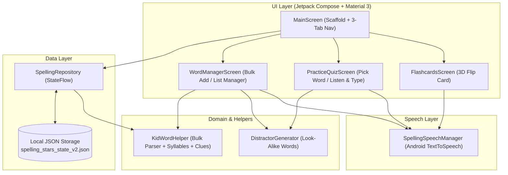

# Architecture & Technical Guide — Spelling Stars

## 1. Overview

**Spelling Stars** is an offline-first, kid-friendly native Android application written in **Kotlin** using **Jetpack Compose (Material 3)**. It helps elementary school students (ages 6–10) prepare for weekly spelling tests through interactive 3D flip flashcards, Text-to-Speech (TTS) audio dictation, and two practice quiz modes:

1. **🎯 Pick Word (Look-Alike Multiple Choice):** Plays the spoken word (with unlimited replays, slow-motion speed, and context sentence audio) and presents the real spelling alongside **2 automatically generated, kid-plausible misspellings**.
2. **⌨️ Listen & Type:** Plays the spoken word and lets the student type the spelling from dictation, offering a first/last letter hint and letter-by-letter visual comparison.

All data is stored locally on the device (`filesDir/spelling_stars_state_v2.json`) with zero external network calls, zero ads, and zero tracking.

---

## 2. Project Structure

```text
spelling-stars/
├── app/
│   ├── build.gradle.kts                  # App module Gradle configuration (compileSdk 36, minSdk 24)
│   └── src/
│       ├── main/
│       │   ├── AndroidManifest.xml       # App manifest (no internet permission required)
│       │   └── kotlin/com/spellingstars/app/
│       │       ├── MainActivity.kt       # Single-activity entry point with Edge-to-Edge Compose
│       │       ├── Navigation.kt         # Navigation3 host container
│       │       ├── NavigationKeys.kt     # Serializable navigation keys
│       │       ├── data/
│       │       │   ├── SpellingModels.kt       # Core data models (WeeklySpellingList, SpellingWord, MasteryStatus)
│       │       │   ├── SpellingRepository.kt   # StateFlow reactive store + JSON file persistence
│       │       │   ├── DistractorGenerator.kt  # Phonetic & orthographic look-alike word generator
│       │       │   └── KidWordHelper.kt        # Bulk word parser, syllable chunker & kid-friendly dictionary
│       │       └── ui/
│       │           ├── main/
│       │           │   ├── MainScreen.kt       # Top app bar, star counter, & 3-tab Bottom Navigation
│       │           │   └── LayoutPreviews.kt   # Multi-device & large-font @Preview definitions
│       │           ├── flashcards/
│       │           │   └── FlashcardsScreen.kt # 3D Y-axis animated flip card, vowel/consonant tiles, TTS bar
│       │           ├── quiz/
│       │           │   └── PracticeQuizScreen.kt # Dictation speaker card, Pick Word & Listen & Type modes
│       │           ├── words/
│       │           │   └── WordManagerScreen.kt  # Weekly list selector, Bulk Add dialog, Word editor
│       │           ├── tts/
│       │           │   └── SpellingSpeechManager.kt # Android TextToSpeech wrapper (Normal, Slow 0.58x, A-B-C)
│       │           └── theme/
│       │               ├── Color.kt            # Playful elementary palette (StarPurple, SkyBlue, SunshineYellow, MintGreen)
│       │               ├── Theme.kt            # Material 3 color scheme setup
│       │               └── Type.kt             # Typography configuration
│       ├── test/kotlin/com/spellingstars/app/ui/main/
│       │   └── MainScreenViewModelTest.kt      # JUnit4 unit tests for distractors, bulk parsing & repository
│       └── androidTest/kotlin/com/spellingstars/app/ui/main/
│           └── MainScreenTest.kt               # Compose UI instrumentation test
├── docs/
│   ├── screenshots/                      # High-resolution rendered screen captures
│   ├── ARCHITECTURE.md                   # This technical architecture document
│   ├── USER_GUIDE.md                     # Parent & Kid step-by-step usage guide
│   └── PRIVACY_POLICY.md                 # Children's privacy & offline data policy
└── README.md                             # Main project overview with embedded screenshots
```

---

## 3. System Architecture Diagram



---

## 4. Key Algorithms & Design Decisions

### 4.1 Look-Alike Word Generation (`DistractorGenerator.kt`)
When testing a child in **🎯 Pick Word** mode, random dictionary words are too easy to eliminate. `DistractorGenerator` creates **2 realistic misspellings** for any target word using six ordered orthographic strategies:
1. **Curated Common Kid Misspellings:** Known tricky words (`because` → `becuase`, `becasue`; `friend` → `freind`, `frend`; `believe` → `beleive`, `belive`).
2. **Phonetic Pattern Swaps:** Swaps common English vowel teams and digraphs (`ea` ↔ `ee`, `ie` ↔ `ei`, `ai` ↔ `ay`, `oa` ↔ `ow`, `ph` → `f`, `tion` → `shun`, `ck` → `k`, `le` ↔ `el`, `er` ↔ `ur`).
3. **Double-Letter Deduplication:** Reduces double letters to single (`butterfly` → `buterfly`, `tomorrow` → `tomorow`).
4. **Single Consonant Doubling:** Doubles an internal consonant (`planet` → `plannet`, `habit` → `habbit`).
5. **Silent Trailing `e` Mutation:** Drops or adds a trailing silent `e` (`imagine` → `imagin`).
6. **Adjacent Internal Character Transposition & Vowel Substitution:** Swaps two neighboring internal letters or substitutes an internal vowel so even short 3-letter words always produce 2 distinct, plausible look-alikes.

### 4.2 Bulk Word Entry & Enrichment (`KidWordHelper.kt`)
Parents shouldn't have to type definitions, syllable dots, or example sentences one word at a time on a phone keyboard.
- `KidWordHelper.parseBulkWords(rawInput)` splits multi-line, comma-separated, semicolon-separated, or space-separated word lists, strips punctuation/bullets, and deduplicates case-insensitively.
- `KidWordHelper.enrichWord(rawWord)` looks up a built-in kid-friendly dictionary or falls back to heuristic vowel-consonant syllable chunking (`estimateSyllables`) and a template definition/sentence.
- `SpellingWord.maskedExampleSentence()` blanks out the target word (`_______`) with case-insensitive regex matching so quiz clues never give away the spelling.

### 4.3 Responsive Layout & Large Font Scale (`1.3x`) Support
Children and parents frequently use increased system font sizes (`1.15x` – `1.30x`) on devices like the **Pixel 7** (`360dp–411dp`) and **Pixel 10** (`411dp`).
- **No Fixed Button Heights:** All interactive buttons and cards use `Modifier.defaultMinSize(minHeight = ...)` rather than rigid `.height(...)` modifiers so enlarged text never clips vertically.
- **FlowRow Wrapping:** Filter chips, audio control bars (`Say It`, `🐢 Slow`, `A-B-C`, `Play Word`, `📖 Sentence`), and word metadata badges use `FlowRow` so buttons wrap cleanly onto a second centered line rather than crushing horizontally into 1-character columns.
- **Weighted Text Columns:** Every `Row` pairing a title/description with a trailing action button or badge applies `Modifier.weight(1f)` to the text column and `maxLines = 1, softWrap = false` to the compact badge/button.

